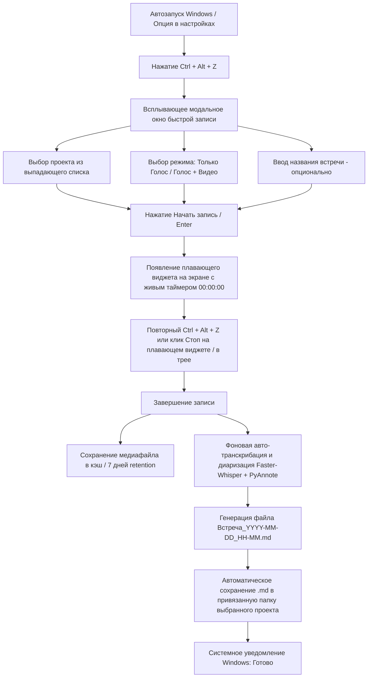

# Техническое Задание (ТЗ): Автономная система записи и транскрибации встреч (Meet Recorder)

> **Статус**: Добавлена настройка управления Автозапуском Windows  
> **Целевая ОС**: Windows 10 / Windows 11  
> **Версия Python**: 3.13 (уже установлена на ПК)  

---

## 1. Общее описание системы

Приложение представляет собой системную утилиту для Windows, работающую в фоновом режиме (системный трей + автозапуск). Оно захватывает как звук системы (голоса собеседников через WASAPI Loopback), так и звук микрофона пользователя. По запросу пользователь может записывать только аудио или аудио с записью экрана (видео).

После завершения записи система локально обрабатывает аудиопоток с помощью **Faster-Whisper** и **PyAnnote**, формирует единый `.md` файл транскрипции со спикерами и сохраняет его в выбранную папку проекта. Тяжёлые исходные аудио/видео записи хранятся локально во временном кэше и **автоматически удаляются через 7 дней**.

---

## 2. Подробный сценарий работы системы (UX / User Flow)



### Подробное описание этапов:

1. **Запуск и фоновый режим**:
   - Приложение работает в системном трее Windows.
   - **Управление Автозапуском**: В Главном окне настроек есть переключатель **«Запускать при старте Windows»** (включение/отключение записи в реестр `HKCU\Software\Microsoft\Windows\CurrentVersion\Run`).

2. **Главное окно (Настройки и Проекты)**:
   - Вкладка **«Проекты»**: Создание проектов (Имя + Папка на диске для сохранения `.md`).
   - Вкладка **«Настройки»**: 
     - **Автозапуск Windows**: Переключатель Вкл/Выкл.
     - **Модель Whisper**: Простой выбор размера модели (`small`, `medium`, `large-v3`). Автоматическая офлайн загрузка.
     - **Срок хранения кэша**: Выбор количества дней (по умолчанию 7 дней).
     - **Горячие клавиши**: Настройка глобального хоткея (`Ctrl + Alt + Z`).

3. **Инициация записи**:
   - Пользователь нажимает глобальное сочетание клавиш **`Ctrl + Alt + Z`**.
   - Появляется быстрая модальная форма (PySide6 overlay):
     - Поле **«Проект»**: выпадающий список созданных проектов.
     - Переключатель **«Режим»**: `Только голос (Audio)` | `Голос + Видео (Audio+Video)`.
     - Поле **«Название»** *(опционально)*.

4. **Процесс записи и плавающий виджет**:
   - На экране поверх всех окон появляется компактный полупрозрачный виджет:
     - 🔴 **Индикатор «ИДЁТ ЗАПИСЬ»**.
     - ⏱️ **Живой таймер длительности** (`00:04:12`).
     - 📁 Имя выбранного проекта.
     - ⏹️ Кнопка «Стоп».
   - Захватываются два независимых звуковых канала (Микрофон + Динамики WASAPI Loopback), а при выборе видео — захват экрана.

5. **Завершение и фоновая обработка**:
   - Повторный нажатие **`Ctrl + Alt + Z`** или клик по «Стоп» в виджете останавливает запись.
   - Виджет скрывается, запускается фоновая транскрибация.
   - По завершении `.md` файл автоматически сохраняется в папку выбранного проекта.
   - Выводится системное уведомление Windows с кнопкой открытия файла.

6. **Политика очистки медиафайлов (7 дней)**:
   - Аудио/видео в кэше хранится 7 дней и затем удаляется для экономии места на диске. `.md` файлы транскриптов остаются в папках проектов навсегда.

---

## 3. Технологический стек

| Компонент | Технология | Описание |
| :--- | :--- | :--- |
| **Язык & Ядро** | Python 3.13 | Основной язык реализации (уже установлен на вашем ПК) |
| **Интерфейс & Виджет** | PySide6 (Qt for Python) | Главное окно, трей, плавающий виджет с таймером, модальные окна |
| **Захват Аудио** | `sounddevice` + WASAPI Loopback | Двухканальный захват: ваш микрофон + звук из колонок/наушников |
| **Захват Видео** | `imageio-ffmpeg` | Высокопроизводительный захват экрана в MP4 |
| **Глобальные хоткеи** | `pynput` / `keyboard` | Перехват `Ctrl + Alt + Z` из любых программ |
| **Транскрибация** | `faster-whisper` | Автоматическая офлайн транскрибация (модели подгружаются автоматически) |
| **Диаризация** | `pyannote.audio` / Channel-tagging | Разделение на Спикер 1, Спикер 2 + подпись (Вы / Собеседники) |

---

## 4. Формат итогового Markdown-файла (`.md`)

```markdown
# Протокол встречи: Проект Альфа
**Дата и время**: 2026-08-25 19:30  
**Проект**: Проект Альфа  
**Длительность**: 00:42:15  
**Режим записи**: Голос + Видео  
**Файл медиа в кэше**: `cache/2026-08-25_19-30_media.mp4` *(будет удален 2026-09-01)*  

---

## Транскрипция встречи

**[00:00:05] Вы (Микрофон)**:  
Всем привет! Давайте начнем обсуждение проекта.

**[00:00:12] Спикер 1 (Динамики)**:  
Привет. Да, давай пройдемся по текущим задачам.
```
